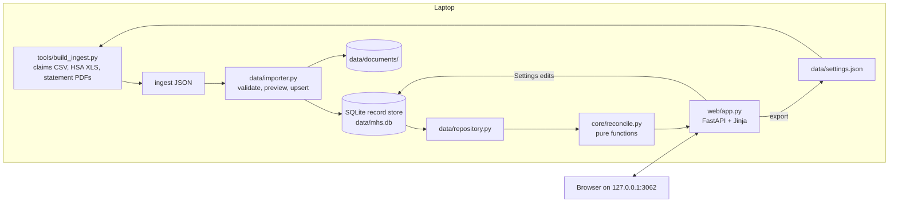
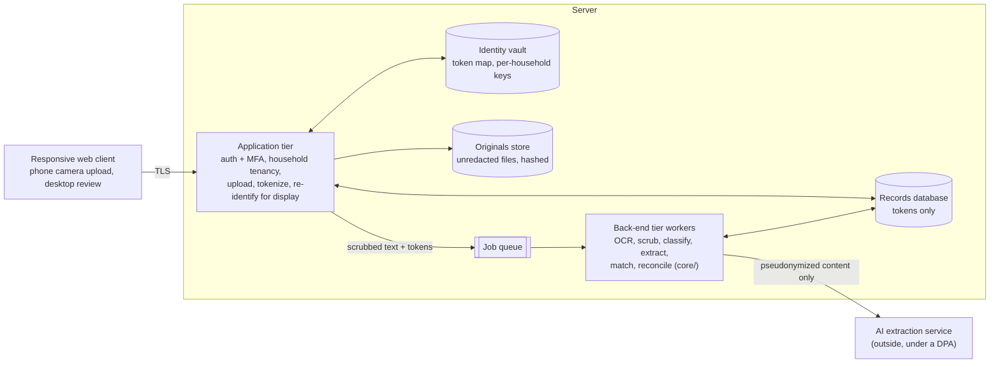

# Architecture

Two architectures are described here: Release 0 as built, and the Release 1 target. Decisions behind it are in [DECISIONS.md](DECISIONS.md); the main choices are summarized at the end.

## Release 0 (built)

A single-user web app on the owner's laptop. Nothing leaves the machine.

| Layer | Code | Responsibility | Rule |
| --- | --- | --- | --- |
| Core | `src/mhs/core/` | Checks, visit status, payment allocation, provider ledgers, HSA flags, plan-limit progress (`reconcile.py`); identities, buckets, line pairing (`lines.py`); match scores (`matching.py`); the member's decisions as record changes (`edits.py`) | Pure functions over record dicts, money in integer cents. No database or web imports. Never changed to suit the UI. |
| Data | `src/mhs/data/` | Record store (one JSON record per kind and id), import validation and upsert, owner-edit protection, money conversion, settings export | The store does not mirror schema fields as columns, so the ingest schema can evolve |
| Web | `src/mhs/web/` | Server-rendered pages, forms, file serving | Binds to 127.0.0.1 only; no login |
| Tools | `tools/build_ingest.py` | Converts real source files into ingest JSON | Reads `data/settings.json` so in-app edits carry through |

Data lives in `data/` (git-ignored): `mhs.db`, `documents/`, `settings.json`.

## Release 1 target

Data resides server-side (decision of Oct 15, 2026). A responsive web client talks to an **application tier**. The application tier owns identity, stores the originals and hands tokenized, scrubbed content to a **back-end tier** for extraction, matching and reconciliation. A separate **identity vault** holds the only map from tokens to identifiers.

### Components

| Component | Responsibility | Requirements |
| --- | --- | --- |
| Web client | Server-rendered pages from the Release 0 templates, made responsive; camera capture through the browser file input; no client-side analytics | UX-01 to UX-06, UX-10, PRV-08 |
| Application tier | Sign-in with MFA; every query scoped to the member's household; upload; tokenize identifiers at ingest; re-identify only for the signed-in member's own pages; owner-edit protection | PRV-11, MAT-02, ING-01, PRV-01 to PRV-03, MAT-07 |
| Identity vault | Token ↔ identifier map, encrypted with per-household data keys from a key management service; encrypted backups with tested restore | PRV-01, PRV-06, PRV-07 |
| Originals store | Unredacted files as uploaded, never modified, SHA-256 recorded; reachable only through the application tier | ING-10, DSP-01 |
| Back-end tier | Workers fed by a queue: OCR, identifier scrubbing on text and images, classification, field and line extraction, duplicate detection, matching, reconciliation | ING-02 to ING-05, ING-07, PRV-04, PLT-04, MAT-05, MAT-06, REC-* |
| Core engine | `src/mhs/core/` from Release 0, extended to line level, the three money identities and the nine statuses; still pure functions | REC-01 to REC-05, REC-07, REC-08, REC-11, REC-13, ALC-01, ALC-03, ALC-04 |
| Records database | Visits, claims, lines, allocations, payments, documents (extracted data), findings, owner-edit marks; tokens instead of identifiers | MAT-01, MAT-03, MAT-04, MAT-09 |

### Trust boundaries

| Boundary | What crosses it | Control |
| --- | --- | --- |
| Client → application tier | Uploads, member actions | TLS 1.2+, MFA session, CSRF protection |
| Application tier → back-end tier | Scrubbed text and images with tokens | PRV-04 scrubbing before enqueue; outbound capture tests (TC-PRV-01-1) |
| Back-end tier → AI service | Pseudonymized content only | PLT-04; data-processing agreement, no training on data (MVP ND-9) |
| Application tier ↔ identity vault | Token lookups for display and drafts | Separate service and keys; access logged |

### Code layout

Keep the Release 0 layering and add two packages:

| Package | Holds |
| --- | --- |
| `core/` | Reconciliation, matching and identities (pure) |
| `data/` | Repositories for the records database and owner-edit protection |
| `ingest/` (new) | The upload pipeline (ADR-033): reading values (`values.py`), HSA and claims exports (`hsa.py`, `claims.py`), text from PDFs and photos (`text.py`; OCR in `ocr.py`, Tesseract locally) and identifier scrubbing (`scrub.py`, rules plus Presidio), all run in the application tier; classification and field extraction (`extract.py` layout rules, `ai.py` Claude for households that turned it on, ADR-034) and the queue worker (`worker.py`), run in the back-end tier. Routes and review pages in `web/household/intake.py` |
| `vault/` (new) | Identity vault service, client, encrypted backup and restore; tokenize, normalize (PRV-03), re-identify |
| `web/` | The Release 0 pages (`web/pages.py`, `web/templates/`), mounted by both the Release 0 app (`web/app.py`) and the Release 1 application tier (`web/household/`: sign-in, sessions, uploads, `mhs-admin`), each through a `PagesHost` (ADR-032) |

Phase 1.1 placed the adapters in `data/` (`db.py`, `records.py`, `queue.py`, `objects.py`, `keys.py`, `migrate.py` with SQL in `data/migrations/`; phase 1.2 added `household_store.py`, Release 0's store interface over a household's records, owner-edit marks and import log), the worker and the OCR interface in `ingest/`, and the stack's runtime settings and `mhs-stack` setup commands in `stack.py` (ADR-031).

The Release 0 JSON importer stays as an admin path for migrating the owner's data and for test fixtures.

### Settled choices

| Choice | Decision |
| --- | --- |
| Hosting | Built and tested locally on Docker Compose; production on Google Cloud (ADR-030) |
| Records database and job queue | Postgres, JSONB records, Postgres-backed queue (ADR-027) |
| AI extraction | Claude API on scrubbed, tokenized content under a data-processing agreement (ADR-028) |
| Keys and recovery | Per-household data keys in the host's key management service; recovery through MFA account recovery (ADR-025) |
| Dates and identity | Real dates in the back-end tier; date shifting only for outside AI and analytics; originals and drafts only in the application tier (ADR-022) |
| OCR and scrubbing | PDF text layer first, then the host's OCR in the same account; Presidio on the server finds identifiers; images blanked from OCR word boxes; Tesseract locally (ADR-029) |

## Environments

The same containers run in every environment. Only four adapters change, so the local stack runs offline (ADR-030).

| Adapter | Local (Docker Compose) | Staging and production (Google Cloud) |
| --- | --- | --- |
| Records database and job queue | `postgres` container | Cloud SQL for PostgreSQL |
| Object storage (originals, scrubbed images) | Local folder on a Docker volume | Cloud Storage, one bucket per environment |
| Keys (ADR-025) | Key file on a Docker volume, same envelope-encryption code path | Cloud KMS, one key ring per environment, a data key per household |
| OCR (ADR-029) | Tesseract in the image, run by the app tier (ADR-034) | Document AI Enterprise OCR |

| Environment | Runs | Data | Purpose |
| --- | --- | --- | --- |
| Local | `docker compose up`: `app` (application tier), `worker` (back-end tier), `postgres`, `vault` (identity vault service), plus the one-shot `setup` (secrets) and `migrate` jobs; in the test profile a `capture` proxy and the `tests` runner | Synthetic and sample data only; never the real `data/` folder | Daily development and the full automated suite |
| Staging | Separate Google Cloud project: Cloud Run services and jobs, Cloud SQL, Cloud Storage, Cloud KMS, Document AI | Synthetic data and the redacted scenario library only | Integration with the real cloud services, OCR accuracy runs, restore drills |
| Production | Separate Google Cloud project with the BAA accepted; customer-managed encryption keys; audit logging on | The household's real data | Release 1 from phase 1.6 |

AI extraction (ADR-028) is the one outside service in every environment. Locally it is mocked by default, so tests stay offline and deterministic; a flag turns on real calls with synthetic documents.

Only the application tier publishes a port: locally 127.0.0.1:3063, registered in `~/Projects/app-registry` as `my-health-spend-r1` (Release 0 keeps 3062). Postgres, the vault and the worker sit on an internal Docker network with no route out. Each tier connects to Postgres as its own role, and household tables enforce isolation with row-level security (ADR-031).

