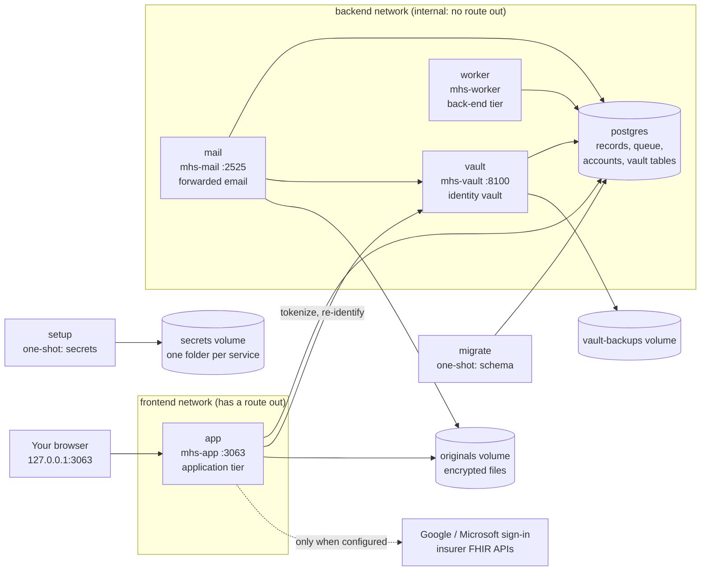
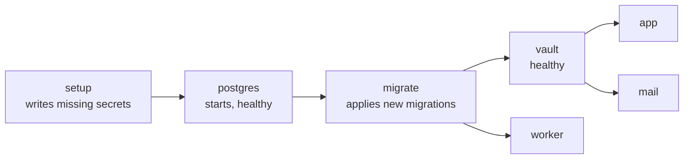
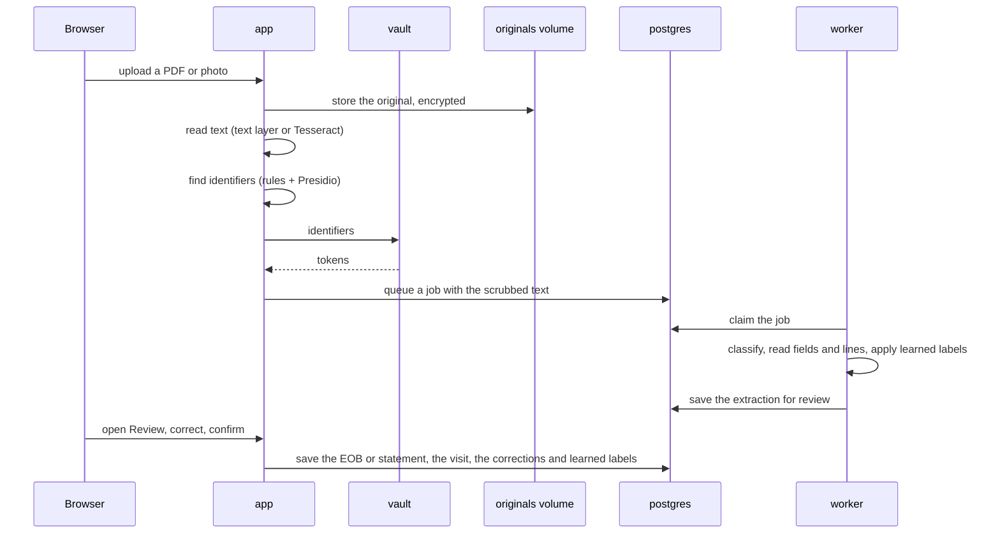
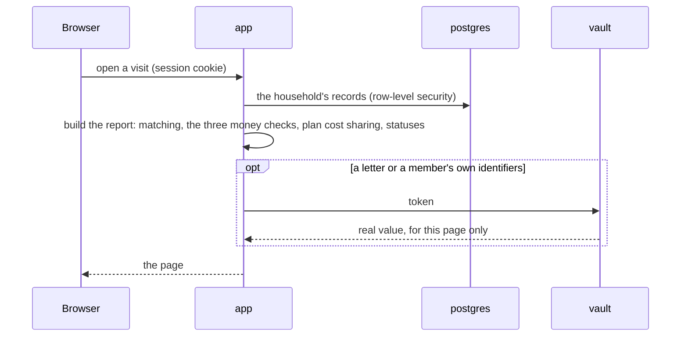
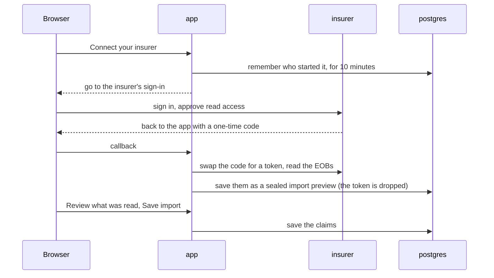

# Containers: what each one does

The Release 1 stack in `compose.yaml`, container by container: what each one is for, what it can reach, what it holds, and how the containers work together on the main paths through the app. The design behind it is in [ARCHITECTURE.md](ARCHITECTURE.md); the Google Cloud equivalent of each container is in [DEPLOYMENT.md](DEPLOYMENT.md) "Services".

Every container except `postgres` and the test tools runs the same image (`mhs:dev`, built from the `Dockerfile`) with a different command. What separates them is their command, their database role, the secrets folder they mount and the network they sit on.

## The whole stack

`app` is the only container on both networks and the only one with a published port (on 127.0.0.1, so only your machine can reach it). `postgres`, `vault`, `worker` and `mail` are on the `backend` network, which Docker marks internal: they can reach each other but nothing on the internet. `setup` has no network at all.

## Start-up order

`setup` and `migrate` run once and exit with code 0; that's what "Exited" means for them in `docker compose ps`. `migrate` prints which migrations it applied (for example `014_payer_pull`).

## Each container

### setup (one-shot)

- **Command:** `mhs-stack init-secrets /secrets`
- **Does:** creates any secret that doesn't exist yet in the `secrets` volume and keeps existing ones, so restarting never changes a password. The secrets are the Postgres admin password, one database password per role (app, worker, vault), the token the app uses to call the vault, and two key-encryption keys (one for the app, one for the vault).
- **Lays them out one folder per service** (`stack.py` `SECRET_LAYOUT`), and each service mounts only its own folder, read-only. The worker's folder holds only its database password: no keys and no vault token.
- **Network:** none.

### postgres

- **Image:** `postgres:17-alpine`.
- **Holds:** every household's records as JSON rows (`app.records`), the job queue, members, sessions, the security and access logs, service settings, import previews, sealed household keys and, in its own schema, the vault's token map.
- **Isolation:** each tier connects as its own role (`mhs_app`, `mhs_worker`, `mhs_vault`) with only the grants it needs, and household tables have row-level security, so a query can only see the household it was opened for (ADR-031).
- **Data:** the `pgdata` volume. `docker compose --profile test down -v` wipes it.
- **Network:** backend only.

### migrate (one-shot)

- **Command:** `mhs-stack migrate`
- **Does:** connects as the admin user, sets the three role passwords from the secrets, and applies each numbered SQL file in `src/mhs/data/migrations/` that hasn't run yet. It's the only container that holds the admin password.
- **Network:** backend only.

### vault: the identity vault

- **Command:** `mhs-vault serve`, a small HTTP service on port 8100, internal only.
- **Does:** keeps the only map between tokens and real identifiers (names, member IDs, account numbers), encrypted with its own key per household. The app sends it an identifier and gets a token back while scrubbing a document; it asks for the identifier back only to show a member's own pages or draft a letter they asked for. Every call needs the vault token.
- **Why it's separate:** a leak of the records database alone gives tokens, not names (PRV-01, ADR-012).
- **Holds:** its key-encryption key and the `vault-backups` volume for encrypted backups (SETUP.md "Back up and restore the vault").
- **Network:** backend only.

### app: the application tier

- **Command:** `mhs-app`, the web app on port 3063 (FastAPI, server-rendered pages).
- **Sign-in and sessions:** password, the authenticator code (an owner setting on the admin screen), recovery codes, and Google or Microsoft sign-in when configured. The session cookie is the only thing that identifies a member.
- **Pages:** every page you use. Home, Visits, the visit page, Plan ahead, Household, Providers, Charges, Cases, HSA and tax, Settings, Import, Uploads, Account, Your data, Consent and the admin screen. The pages build their report from the household's records when they're shown: the reconciliation engine (`core/`) runs inside this container, on the records Postgres returns for that household.
- **Uploads:** stores the original file encrypted in the `originals` volume, reads its text (PDF text layer, or Tesseract OCR for photos and scans), finds identifiers (rules plus Presidio) and swaps them for vault tokens, then puts a job on the queue with only the scrubbed text. When the worker has read it, the member reviews and confirms here.
- **Outbound calls, only when configured:** Google or Microsoft for sign-in, and an insurer's FHIR API for "Connect your insurer". Neither token is kept.
- **Letters** for disputes are drafted here when asked, with real identifiers from the vault, and never stored.
- **Networks:** frontend (for the published port and outbound calls) and backend.

### mail: forwarded email

- **Command:** `mhs-mail`, an SMTP receiver on port 2525, internal only.
- **Does:** takes email sent to a household's private address, checks that the sender is a member who has given consent, and turns each attachment into an upload. It runs exactly the same upload steps as `app` (encrypt, read, scrub, queue), so it mounts the app's secrets folder.
- **Locally,** only the tests send it mail. In Google Cloud it needs an inbound-mail service instead, which isn't built yet (GCP_SETUP.md open item 7).
- **Network:** backend only.

### worker: the back-end tier

- **Command:** `mhs-worker`
- **Does:** takes jobs from the Postgres queue. For an `extract` job it classifies the scrubbed text (EOB, statement, itemized bill, and so on), reads the fields and service lines with the layout rules, checks the arithmetic, applies what it learned from the member's earlier corrections for that sender, and writes the result for review.
- **Can't:** read originals, decrypt anything, call the vault, or reach the internet. It never sees a name or an ID number, only tokens.
- **AI reading:** with `MHS_EXTRACTOR=claude`, an API key and an egress proxy, a worker also takes `extract_ai` jobs for households that turned AI reading on. It shifts each person's dates before the call and back after. In the normal stack it stays on the rules.
- **Network:** backend only.

## How the containers work together

### Uploading a document

### Showing a page

### Connecting an insurer

## Test-only containers

These start only with `--profile test` (`docker compose --profile test run --rm tests`).

| Container | Does |
| --- | --- |
| `tests` | Runs the whole test suite inside the stack, against the running `app`, `mail` and `postgres`. |
| `capture` | A proxy (mitmproxy) on both networks. The AI worker's only way out goes through it: it answers AI calls with recorded responses and logs every request, so a test can prove no name or ID number left the stack (TC-PLT-04-1). |
| `worker-ai` | A worker with AI reading on, pointed at `capture`; no real key and no real API call. |
| `fake-gcs` | Stands in for Google Cloud Storage, so the cloud storage code is tested without a Google account. |

## Volumes

| Volume | Holds | Used by |
| --- | --- | --- |
| `secrets` | Generated passwords, the vault token and the two key-encryption keys, one folder per service | each service, its own folder, read-only |
| `pgdata` | The database | postgres |
| `originals` | Uploaded files, encrypted per household | app, mail (tests read-only) |
| `vault-backups` | Encrypted vault backups | vault |
| `captures` | The test proxy's request log | capture, tests |
