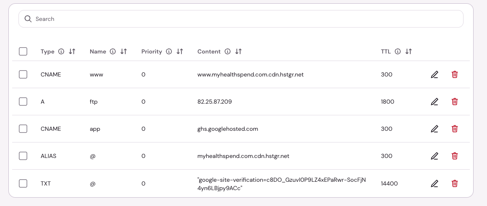

# Google Cloud staging setup, step by step

How to stand up the `mhs-staging` project (phase 1.3) from nothing. It is Stages 1 and 2 of [OWNER_SETUP.md](OWNER_SETUP.md), the checklist of everything the owner sets up outside the code. The plan behind it is in [DEPLOYMENT.md](DEPLOYMENT.md). **Staging holds synthetic data only.** Parts A to C were first run against a real project on 2026-11-14 (`mhs-staging-512010`), which fixed three things the dry runs couldn't catch: a Cloud SQL flag this gcloud doesn't have, the wait for newly enabled APIs, and secrets for worker pools. The scripts are also tested with `--dry-run` (`tests/test_gcp_scripts.py`).

Every script takes `PROJECT_ID` (required) and `REGION` (default `us-east4`), checks whether each resource exists before creating it, and prints every command without running anything under `--dry-run`. Try that first:

```bash
PROJECT_ID=mhs-staging-12345 tools/gcp/setup.sh --dry-run
```

## Part A: only the owner can do this

1. **Google Cloud account and billing.** Sign in at console.cloud.google.com, create a billing account and add a payment method.
2. **Budget alerts.** Billing > Budgets & alerts: a budget of, say, $50 a month for the project, with alerts at 50%, 90% and 100%.
3. **Install gcloud** (`brew install --cask google-cloud-sdk`; Homebrew now names it `gcloud-cli`). Homebrew's gcloud lacks the `grpc` module that `gcloud run worker-pools` needs, so give gcloud its own environment once: `gcloud config virtualenv create --enable-virtualenv`. Then sign in twice (the second is for tools on your laptop, such as the accuracy run):
   ```bash
   gcloud auth login
   ```
   ```bash
   gcloud auth application-default login
   ```
4. **Create the project** and link billing. Project ids are global, so `mhs-staging` is likely taken; add a suffix:
   ```bash
   gcloud projects create mhs-staging-12345 --name="mhs-staging"
   ```
   ```bash
   gcloud billing projects link mhs-staging-12345 --billing-account=<ACCOUNT_ID>
   ```
5. **Docker** running locally (the image is built on your laptop for `linux/amd64`).
6. **Later, for production only:** accept the BAA in the console and check every service against Google's HIPAA covered-products list (DEPLOYMENT.md). The scripts refuse a project id containing `prod` unless `MHS_ALLOW_PRODUCTION=1`.

## Part B: resources (`tools/gcp/setup.sh`)

```bash
PROJECT_ID=mhs-staging-12345 tools/gcp/setup.sh
```

It runs these steps in order; name steps to run just those (`tools/gcp/setup.sh sql`).

| Step | What it creates |
| --- | --- |
| B1 `apis` | Cloud Run, Cloud SQL Admin, Secret Manager, KMS, Storage, Document AI, Artifact Registry, Service Networking, Compute, Logging |
| B2 `network` | VPC `mhs-vpc`, subnet `mhs-run` (10.8.0.0/24, Private Google Access) for Cloud Run Direct VPC egress, private services access range `mhs-psa` (10.10.0.0/20) peered for Cloud SQL, and firewall rules: services tagged `mhs-no-egress` (worker, migrate) reach Postgres on 5432 and nothing else. No Cloud NAT, so nothing reaches the internet. |
| B3 `bucket` | `gs://<project>-originals`: uniform access, public access prevention, versioning |
| B4 `kms` | Key ring `mhs` with symmetric keys `app` and `vault` |
| B5 `accounts` | `mhs-app`, `mhs-vault`, `mhs-worker`, `mhs-worker-ai`, `mhs-migrate`, with the roles in DEPLOYMENT.md "Identities and access" |
| B6 `secrets` | `mhs-db-admin-password`, `mhs-db-{app,worker,vault}-password`, `mhs-vault-token`, `mhs-member-password`: values from `openssl rand` piped straight into Secret Manager, never shown; access granted per secret |
| B7 `sql` | Cloud SQL `mhs-pg`, PostgreSQL 17, Enterprise edition, `db-f1-micro` (`SQL_TIER`), private IP only, TLS required, daily backups and point-in-time recovery, deletion protection; database `mhs`; the `postgres` password set from the secret. About ten minutes. |
| B8 `registry` | Artifact Registry Docker repository `mhs` |
| B9 `docai` | Document AI Enterprise OCR processor `mhs-ocr` in `us` (REST; gcloud has no processor commands) |

B10. **Anthropic key (only if AI extraction will be on, and only under the data-processing agreement, ADR-028):** paste it into Secret Manager yourself, then rerun `setup.sh secrets` to grant it to `mhs-worker-ai`:

```bash
gcloud secrets create mhs-anthropic-api-key --data-file=- --project=mhs-staging-12345
```

B11. **Sign-in providers (optional):** add each provider's secrets (OWNER_SETUP.md 3a lists the names: `mhs-google-client-id`, `mhs-google-client-secret` and so on), then rerun `setup.sh secrets` to grant them to `mhs-app`. `deploy.sh` turns on each provider whose secrets all exist, as environment variables from Secret Manager, so every later deploy keeps them.

## Part C: deploy (`tools/gcp/deploy.sh`)

```bash
PROJECT_ID=mhs-staging-12345 tools/gcp/deploy.sh
```

| Part | What it does |
| --- | --- |
| `image` | Builds `git archive HEAD` (committed files only, so `data/` can never get in) for `linux/amd64`, target `runtime`, and pushes it as `<region>-docker.pkg.dev/<project>/mhs/mhs:<commit>`. Skipped if that tag exists. |
| `migrate` | Cloud Run job `mhs-migrate` (`mhs-stack migrate`, admin user `postgres`), then runs it |
| `vault` | Service `mhs-vault`: ingress internal, port 8100, `vault` KMS key |
| `app` | Service `mhs-app`: public, port 3063, `MHS_COOKIE_SECURE=1`, `MHS_PUBLIC_URL` = its run.app address (or `PUBLIC_URL`), GCS, KMS `app` key, Document AI, Presidio, and the sign-in providers whose secrets exist (B11) |
| `worker` | Worker pool `mhs-worker` (layout rules), tag `mhs-no-egress`; `WORKER_INSTANCES=0` pauses it. Worker pools can't mount secrets as files yet, so its database password (and the AI worker's key) arrive as environment variables |
| `admin` | Job `mhs-admin` running as `mhs-app` |
| `worker-ai` | Only with `--with-ai` and `MHS_AI_PROXY` set (see open items) |

## Part D: a synthetic household (`tools/gcp/admin.sh`)

```bash
PROJECT_ID=mhs-staging-12345 tools/gcp/admin.sh demo-setup
```

It runs the job and prints its output from Cloud Logging: the sign-in address, a generated password and the authenticator secret and enrolment link. Also `create-household "Name"`, `add-member --household <id> --email … --name …` (password generated into `mhs-member-password`; the script prints the command to read it) and `import --household <id> /srv/mhs/samples/example-ingest.json --yes`. Then upload `samples/demo/` and follow [DEMO.md](DEMO.md).

## Part E: is it working?

Automatic checks (app answers over HTTPS, vault refused from the internet, no public IP on Cloud SQL, backups and PITR on, bucket locked down, worker holds no bucket or key access):

```bash
PROJECT_ID=mhs-staging-12345 tools/gcp/check.sh
```

Then DEPLOYMENT.md "Staging checks" by hand:

1. **Deploy, migrate, synthetic household:** parts C and D; sign in, upload a scanned demo document and see it reach "Review" (Document AI and the worker both work).
2. **Suite and corpus:** the user scenarios in TESTING.md against the app's URL; the corpus run needs an OCR option first (open items).
3. **Restore drill:** point-in-time clone, then sign in against it:
   ```bash
   gcloud sql instances clone mhs-pg mhs-pg-restore --point-in-time=<RFC3339 time> --project=mhs-staging-12345
   ```
   Restoring into a fresh project uses `gcloud sql backups restore <backup-id> --restore-instance=<instance> --backup-instance=mhs-pg --backup-project=mhs-staging-12345 --project=<new project>`. The vault backup half waits on an open item.
4. **AI egress capture:** waits on the egress proxy (open items).

## Cost (estimates, check against Google's pricing pages)

Rough monthly figures for the smallest sizes in `us-east4`, October 2026; they are estimates, not quotes.

| Item | Estimate |
| --- | --- |
| Cloud SQL `db-f1-micro`, 10 GB SSD, backups | ~$12 |
| Worker pool, 1 vCPU / 1 GiB, always on | ~$40–55 (pause with `WORKER_INSTANCES=0`) |
| Cloud Run app and vault, scale to zero, light use | ~$0–5 |
| Document AI OCR | ~$1.50 per 1,000 pages |
| KMS (2 keys), Secret Manager (7 secrets), Storage, Artifact Registry | ~$1–2 |
| **Total** | **~$15–20 paused, ~$60–75 with the worker running** |

## Part F: your own domain (`app.myhealthspend.com`)

The marketing site stays at `myhealthspend.com` on Hostinger, and the app gets its own subdomain, pointed at Cloud Run. Its address goes into every sign-in and insurer redirect URI, so do this before registering production OAuth clients. Browsers treat `myhealthspend.com` and `app.myhealthspend.com` as the same site, so a member who follows the landing page's "Sign in" link arrives with the app's `SameSite=Strict` session cookie intact. Don't frame the app in the Hostinger site, mask its address, or proxy it through Hostinger: Google, Microsoft and Apple refuse to show their sign-in pages in a frame, the app's policy forbids framing, and a proxy would put health data through a host outside ADR-028.

The domain's DNS is at Hostinger (nameservers `*.dns-parking.com`), with no CAA records, so Google can issue the certificate without any change there. The steps below use Cloud Run **domain mapping**: free, and the quickest way to a branded address, but Google still calls it a preview and says it can add latency in `us-east4`. That's fine for staging. Production should use the load balancer (see the end of this part).

1. **Prove you own the domain** (once per Google account; the same proof lets the OAuth consent screen list `myhealthspend.com` as an authorized domain):
   ```bash
   gcloud domains verify myhealthspend.com
   ```
   It opens Google Search Console with a `TXT` record to add. In hPanel: Domains, `myhealthspend.com`, DNS / Nameservers, "Add record": type `TXT`, name `@`, the value Google gives, TTL 3600. Leave the existing `TXT` records alone (a domain can have several). Click Verify in Search Console once the record shows (`dig +short TXT myhealthspend.com`), usually within minutes.
2. **Map the subdomain to the app:**
   ```bash
   gcloud beta run domain-mappings create --service=mhs-app --domain=app.myhealthspend.com --region=us-east4 --project=mhs-staging-12345
   ```
3. **Read the record Google wants:**
   ```bash
   gcloud beta run domain-mappings describe --domain=app.myhealthspend.com --region=us-east4 --project=mhs-staging-12345 --format="yaml(status.resourceRecords)"
   ```
   For a subdomain it is a `CNAME` to `ghs.googlehosted.com.`
4. **Add it at Hostinger:** hPanel, DNS / Nameservers, "Add record": type `CNAME`, name `app`, target `ghs.googlehosted.com`, TTL 300 while you set up (raise it to 3600 later). Change nothing for `@` or `www`: they keep serving the landing page. Check it from your laptop:
   ```bash
   dig +short CNAME app.myhealthspend.com
   ```
5. **Wait for the certificate.** Google issues it once the record resolves: usually 15 to 60 minutes, at most 24 hours. Repeat the `describe` from step 3 without `--format` until `CertificateProvisioned` and `Ready` are `True`. Until then `https://app.myhealthspend.com` shows a certificate error; the `run.app` address keeps working.
6. **Redeploy the app and the admin job with the new address**, so enrolment links and redirect URIs use it:
   ```bash
   PUBLIC_URL=https://app.myhealthspend.com PROJECT_ID=mhs-staging-12345 tools/gcp/deploy.sh app admin
   ```
   Pass the same `PUBLIC_URL` to every later `deploy.sh` run, or it goes back to the `run.app` address.
7. **Check it:**
   ```bash
   PUBLIC_URL=https://app.myhealthspend.com PROJECT_ID=mhs-staging-12345 tools/gcp/check.sh
   ```
   Then sign in at `https://app.myhealthspend.com/signin` and post a form (any setting): a refused post means the proxy-header workaround (open item 1) didn't go out with the deploy.
8. **Point the sign-in providers at it.** Add `https://app.myhealthspend.com/signin/with/<provider>/callback` to the Google and Microsoft clients and to Apple's Services ID (Apple also wants `app.myhealthspend.com` under "Domains and Subdomains"), and `/connect/<payer>/callback` to each insurer registration. SETUP.md "Social sign-in" has the details, and OWNER_SETUP.md 3a the secrets `deploy.sh` reads. Remove the `run.app` URIs once the domain works.
9. **Link to it from the landing page.** On the Hostinger site, "Sign in" goes to `https://app.myhealthspend.com/signin`. A short address such as `myhealthspend.com/login` can be a 301 redirect to the same place (hPanel's Redirects page for the website); that's a convenience only, the app itself is never framed or proxied.

**As set up for staging (2026-11-19).** Project `mhs-staging-512010`. The domain was verified in Search Console and the mapping created on 2026-11-19; Google then reported the `app` record as correct and the certificate as pending. The DNS records at Hostinger afterwards ([screenshot](images/hostinger-dns-2026-11-19.png)):

| Type | Name | Content | TTL | What it's for |
| --- | --- | --- | --- | --- |
| ALIAS | `@` | `myhealthspend.com.cdn.hstgr.net` | 300 | The landing page on Hostinger (Hostinger's own) |
| CNAME | `www` | `www.myhealthspend.com.cdn.hstgr.net` | 300 | The landing page at `www` (Hostinger's own) |
| A | `ftp` | `82.25.87.209` | 1800 | Hostinger file upload (Hostinger's own) |
| TXT | `@` | `google-site-verification=c8DO_…9ACc` | 14400 | Step 1: proves to Google that you own the domain. Keep it: removing it can undo the verification |
| CNAME | `app` | `ghs.googlehosted.com` | 300 | Step 4: the app on Cloud Run |



Two notes from doing it:
- In hPanel's "Add record" form, the `TXT` record's Name is `@` and its value is the whole `google-site-verification=…` string, without quotation marks. `dig` shows TXT values in quotes; they aren't part of the value.
- The first `gcloud beta` command asks to install the "gcloud Beta Commands" component; answer yes.

**For production: a load balancer instead.** A global external Application Load Balancer with a serverless network endpoint group for `mhs-app` and a Google-managed certificate for `app.myhealthspend.com`. At Hostinger the `app` record becomes an `A` record to the load balancer's static IP. It costs about $18 a month or more, avoids the domain-mapping latency, and lets Cloud Armor add rate limits and a web firewall in front of sign-in. Turn the app's ingress to "internal and load balancing" afterwards, so the `run.app` address no longer reaches it. Not scripted yet (open items).

Not for this app: **Firebase Hosting** in front of Cloud Run. It forwards only one cookie, named `__session`, so the session, flow and view cookies would never reach the app.

## Part G: tear it down

```bash
PROJECT_ID=mhs-staging-12345 tools/gcp/teardown.sh --delete-project
```

Shuts down the whole project (undo within 30 days with `gcloud projects undelete`); simplest and complete. Without `--delete-project` it deletes the resources one by one and keeps the project: Cloud KMS never deletes key rings or keys, so their versions are destroyed instead. Both ask you to type the project id. The billing account and budget stay yours to close.

## Open items (what the code doesn't do yet)

1. **Posts behind Cloud Run's TLS:** the app's same-origin check compares the browser's `https://` origin with the request's scheme, and `mhs-app` starts uvicorn with `proxy_headers=False`, so every post would be refused. `deploy.sh` works around it by starting uvicorn directly with `--proxy-headers --forwarded-allow-ips=*` (safe on Cloud Run: only Google's front end reaches the container, and the app doesn't use client IPs). The code fix: compare against `MHS_PUBLIC_URL`, or a setting that turns proxy headers on.
2. **Vault and Cloud Run IAM:** the app sends the vault token in `Authorization`, the header Cloud Run's IAM check uses, so the vault runs with `--no-invoker-iam-check` and relies on internal ingress plus its token. Defence in depth would have the app send a Google ID token in `X-Serverless-Authorization` and turn the check on.
3. **mhs-admin output goes to Cloud Logging:** passwords, authenticator secrets and enrolment links printed by the job stay in the project's logs for 30 days. Acceptable for synthetic staging; production needs a way to hand them over without printing (or a log exclusion).
4. **add-member has no non-interactive password source** except `--password-stdin`; `admin.sh` feeds it from the mounted `mhs-member-password` secret with `sh -c`.
5. **Vault backups on Cloud Run:** `mhs-vault backup --out` writes a local file, which a job loses. It needs a GCS destination and the passphrase as a secret (`MHS_BACKUP_PASSPHRASE_FILE`).
6. **AI worker egress proxy:** Cloud Run can't allow just one domain; `worker-ai` needs a proxy (for example Secure Web Proxy or a small Squid VM) that only lets `api.anthropic.com` through. Until then `deploy.sh` won't deploy it.
7. **Inbound email (ADR-039):** `mhs-mail` speaks SMTP, which Cloud Run can't receive. It needs an inbound-mail provider posting to an HTTP endpoint the app doesn't have yet, plus a domain with MX records.
8. **Corpus through Document AI:** `tools/extraction_accuracy.py` has no OCR option; scanned corpus documents need one to measure Document AI.
9. **Cloud SQL's `postgres` user isn't a true superuser.** The migrations use nothing that needs one (no extensions, no `BYPASSRLS`), but the first real `migrate` run is the proof.
10. **KMS key rotation** isn't set; old versions keep unwrapping, so turning it on later is safe.
11. **The load balancer** for production (Part F) isn't scripted.
